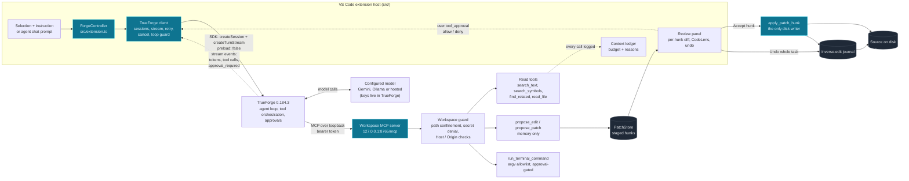
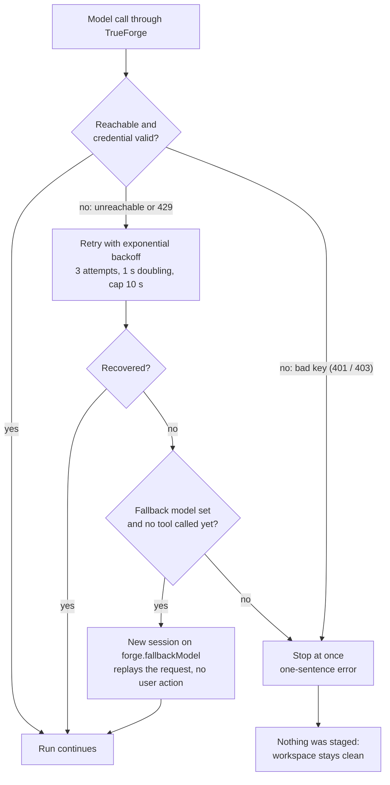

<h1 align="center">Forge Agent</h1>

<p align="center"><strong>A review-gated coding agent for VS Code, running its agent loop on TrueFoundry TrueForge.</strong><br/>
The model decides what to read and what to change. The editor decides what reaches the disk.</p>

<p align="center">
  <a href="#demo-video">Demo</a> ·
  <a href="#architecture">Architecture</a> ·
  <a href="#how-context-is-selected">Context</a> ·
  <a href="#quick-start">Quick start</a> ·
  <a href="#the-three-fixed-tasks">Tasks</a> ·
  <a href="#evidence">Evidence</a> ·
  <a href="#judge-scorecard">Scorecard</a> ·
  <a href="#limitations">Limitations</a>
</p>

<p align="center">
  
  
  
  
</p>

> [!IMPORTANT]
> Forge Agent holds no model-provider key and never calls a model provider. All reasoning, sessions, tool orchestration and approvals belong to **TrueForge**, which must be running locally. Provider keys are entered inside TrueForge only.

> [!WARNING]
> Approved terminal commands run as your local user and are **not** sandboxed. They are limited to an exact allowlist (see [Safety invariants](#safety-invariants)). Review every command and use a disposable clone for untrusted work.

This is the IIT Bombay Techfest / TrueFoundry **Forge-a-thon** Round 1 submission by team **Three Winners** (Team ID `TM-7164696B5DD`). Target workspace: [pallets/flask](https://github.com/pallets/flask) tag **3.1.3** (`22d92470`), sibling checkout at `../flask`.

| Demo video | Write-up PDF | Repository |
| --- | --- | --- |
| [youtu.be/uy5ithxDSoI](https://youtu.be/uy5ithxDSoI) (4:00) | [Google Drive folder](https://drive.google.com/drive/folders/1sjT6-KtvXz5Syp3XEFC-v05beu-45A1S?usp=drive_link) | [Truefoundry-IITB-Forge-a-thon](https://github.com/AbhishekGupta0164/Truefoundry-IITB-Forge-a-thon) |

---

## Contents

- [Demo video](#demo-video)
- [What Forge Agent does](#what-forge-agent-does)
- [Architecture](#architecture)
- [How context is selected](#how-context-is-selected)
- [How it uses TrueForge](#how-it-uses-trueforge)
- [Quick start](#quick-start)
- [The three fixed tasks](#the-three-fixed-tasks)
- [Evidence](#evidence)
- [Settings and commands](#settings-and-commands)
- [Repository layout](#repository-layout)
- [Limitations](#limitations)
- [Judge scorecard](#judge-scorecard)
- [Team, tools and licence](#team-tools-and-licence)

---

## Demo video

One 4:00 screen recording of all three Forge-a-thon tasks on `pallets/flask` 3.1.3, each followed by its check on screen. Click the thumbnail to watch.

[](https://youtu.be/uy5ithxDSoI)

| Time | Chapter | What you see |
| --- | --- | --- |
| [0:00–0:03](https://youtu.be/uy5ithxDSoI) | Intro | Forge Agent shows its sources and never writes without you |
| [0:03–1:34](https://youtu.be/uy5ithxDSoI?t=3) | **Task A, inline edit** | Self-test confirms ports and gateway. `get_debug_flag` selected, one plain-English instruction, a hunk with Accept and Reject ([0:49](https://youtu.be/uy5ithxDSoI?t=49)). After Accept, `FLASK_DEBUG=off` prints `False` ([1:08](https://youtu.be/uy5ithxDSoI?t=68)), `git status` shows one modified file, then undo returns a clean tree ([1:21](https://youtu.be/uy5ithxDSoI?t=81)) |
| [1:34–2:23](https://youtu.be/uy5ithxDSoI?t=94) | **Task B, agent mode** | One request, no files named. The agent explores the project first ([1:44](https://youtu.be/uy5ithxDSoI?t=104)), then proposes 3 files (`cli.py`, `test_cli.py`, `docs/cli.rst`), each with its own diff ([1:51](https://youtu.be/uy5ithxDSoI?t=111)). Tests pass and `flask config` prints masked JSON ([2:15](https://youtu.be/uy5ithxDSoI?t=135)) |
| [2:23–2:33](https://youtu.be/uy5ithxDSoI?t=143) | **Localhost (TrueForge session)** | The TrueForge session view for Task B: 1 turn, 1 min 43 s, 25 tool calls |
| [2:33–4:00](https://youtu.be/uy5ithxDSoI?t=153) | **Task C, resilience** | Primary model broken ([2:40](https://youtu.be/uy5ithxDSoI?t=160)); HTTP 422 reported, fallback takes over ([2:55](https://youtu.be/uy5ithxDSoI?t=175)); editor stays responsive ([3:05](https://youtu.be/uy5ithxDSoI?t=185)); fallback proposes one hunk, `helpers.py` untouched before Accept ([3:23](https://youtu.be/uy5ithxDSoI?t=203)); accepted, `FLASK_DEBUG=off` returns `False` again ([3:39](https://youtu.be/uy5ithxDSoI?t=219)); a run is started and Stop pressed ([3:52](https://youtu.be/uy5ithxDSoI?t=232)) |

---

## What Forge Agent does

| Surface | What happens |
| --- | --- |
| **Inline edit** (`Cmd+Alt+K` / `Ctrl+Alt+K`) | Selection, file path, line range and instruction go to a TrueForge session. The model calls `propose_edit` over MCP. Hunks appear as CodeLens **Accept / Reject**. Disk is untouched until Accept. |
| **Agent chat** (Forge Agent icon in the activity bar) | Type a task and press Run. The prompt goes to TrueForge as typed; **no filenames are added** unless you write `@path/file.py` or `@symbol:name`. The model finds code with `search_text`, `search_symbols`, `find_related` and `read_file`, then proposes edits. Tokens, tool calls, the context map and approvals stream into the view. |
| **Review** | Native `vscode.diff`, per-hunk CodeLens, stale-hunk denial, `Forge: Undo Whole Task` through recorded inverse edits (not whole-file snapshots). |
| **Cancel** | `Forge: Cancel Run` calls TrueForge `sessions.cancel`, aborts the local stream, discards unapproved hunks and refuses later applies. |
| **Resilience** | Retry with exponential backoff, single-sentence errors, automatic fallback to a second configured model, loop guard. |
| **MCP** | Loopback-only `127.0.0.1:8765/mcp`, bearer token in VS Code SecretStorage, workspace path confinement, allowlisted `run_terminal_command`. |

---

## Architecture

### System view



### Failure path (Task C)



### Write path and review

1. The model proposes an `old_str` / `new_str` edit (or a unified diff).
2. The server computes the hunks, validates them (Python syntax, new-import resolution, scope), and stages them in `PatchStore`. `git status` stays clean.
3. The native diff opens with Accept and Reject on every hunk.
4. Accept: TrueForge's pause on `apply_patch_hunk` resumes with `user.tool_approval`. The hunk is rechecked against the current document version (a hunk whose own lines changed is denied as stale), written through `WorkspaceEdit`, and an inverse edit is recorded.
5. Undo replays the inverse edits in reverse and reports a conflict if you edited the same span afterwards.

<details>
<summary><strong>MCP tool surface</strong></summary>

| Tool | Purpose | Writes? |
| --- | --- | --- |
| `ping` | Health check | No |
| `search_text` | Bounded text search, at most 30 hits, each with path, line and snippet | No |
| `search_symbols` | Python `ast` symbol lookup with signatures and docstrings (also serves `@symbol`) | No |
| `read_file` | Workspace-relative ranged read, at most 200 lines, with a reason | No |
| `find_related` | Pairs an implementation with its tests and docs by name and references | No |
| `propose_patch` | Stage a multi-hunk unified diff in memory | No, memory only |
| `propose_edit` | Stage a search-and-replace edit; hunks computed server-side with 3-tier matching (exact, whitespace-normalised, anchored) | No, memory only |
| `apply_patch_hunk` | Apply one approved hunk through `WorkspaceEdit` | **Yes, the only writer** |
| `run_terminal_command` | argv array against an exact allowlist, timeout, truncated output | No source edits; approval-gated |

</details>

### Safety invariants

Also in `AGENTS.md`.

- The **only** disk writer is `apply_patch_hunk`, and only after a TrueForge allow for that call.
- The extension **never** calls a model provider. Traffic is TrueForge SDK / HTTP only.
- MCP binds `127.0.0.1` on a fixed port, never `0.0.0.0`, and requires a bearer token stored in VS Code SecretStorage.
- Paths cannot escape the workspace. `..`, symlink escapes, `.git`, `.env`, `*.key` and `*.pem` are denied.
- `run_terminal_command` takes an argv array on an exact allowlist, with `shell: false`. Shell strings, redirects and `git apply` are rejected.
- A loop guard stops a run after 20 tool calls, or 3 identical consecutive calls.

---

## How context is selected

Flask 3.1.3 is about 17,000 lines, larger than most context windows. The agent never receives the repository. It starts with only the request and retrieves what it needs, in this order (details in `docs/context-strategy.md`):

1. **Mentions.** `@file` and `@symbol` are resolved by the extension and sent first, inside the same budget.
2. **Repo map.** A compact outline of modules, classes and functions, under 2,000 tokens.
3. **`search_text` / `search_symbols`.** Finds the entry point (for Task B, the existing `routes_command`).
4. **`find_related`.** Maps a module to its tests and docs: `src/flask/cli.py` gives `tests/test_cli.py` and `docs/cli.rst`. The agent still decides what to open.
5. **`read_file`.** Line ranges only, never whole files, each with a stated reason.

| Retrieved-context budget (`src/shared/constants.ts`, enforced in `src/context/budget.ts`) | Limit |
| --- | ---: |
| Retrieved tokens per run | 12,000 |
| Files consulted per task | 8 |
| Search hits per call | 30 |
| Lines per `read_file` | 200 |

The limits live in the MCP server, not in the prompt. A repeated identical read or search costs nothing, which stops weak models from looping. When a limit is reached the tool returns an explicit "budget exceeded" result instead of silently adding more code.

**Context map.** Every read and search is written to a ledger that the agent chat shows live: path, line range, the reason the model gave, candidates it skipped, and budget used. It is on screen during Task B at [1:44 in the video](https://youtu.be/uy5ithxDSoI?t=104).

---

## How it uses TrueForge

| TrueForge capability | How Forge Agent uses it | Code |
| --- | --- | --- |
| Sessions and streamed turns (TypeScript SDK) | Every agent and inline run: `sessions.create` with an inline agent spec, `sessions.createTurnStream`; events mapped to `token`, `tool_call`, `tool_result`, `approval`, `error`, `done` | `src/trueforge/` |
| Remote MCP server | The editor's capabilities as tools, attached as `forge-workspace` | `src/mcp/` |
| Tool approval | `requireApprovalForTools: ['apply_patch_hunk', 'run_terminal_command']`. TrueForge pauses the turn with `tool.approval_required`; the hunk is already on screen; Accept or Allow resumes it with `user.tool_approval`; Reject or Deny sends the reason back | `src/trueforge/approvals.ts`, `src/review/` |
| Deferred tool loading | The MCP server is attached with `preload: false`, so tool definitions load when the agent first needs them | `src/trueforge/client.ts` |
| Cancel | `sdk.sessions.cancel` plus a local `AbortSignal` | `src/review/cancel.ts` |
| Model catalog | The model is configured inside TrueForge; the extension only passes `provider/model` names | `forge.model`, `forge.fallbackModel` |

Sandbox and subagents are **off on purpose**: every write already goes through one approval-gated tool, and subagents would inherit the same MCP tools (including the writer), so a "read-only" prompt would not be a guard.

No provider API keys live in this repository. `model.example.json` is a placeholder with an empty key.

**Models and cost.** Primary `google-gemini/gemini-3-5-flash`, fallback `google-gemini/gemini-3-1-flash-lite`, temperature 0, called by the local TrueForge daemon. Total cost: **$0** (Gemini free tier, nothing billed). Nothing is deployed.

---

## Quick start

### Prerequisites

- Node.js **22.14+**
- Python **3.9+** (Flask target, `scripts/symbols.py`, `scripts/check_py.py`)
- VS Code **1.90+**, Git
- A model reachable from TrueForge: a hosted provider key (for example Gemini) or a local model through Ollama

### 1. Build the extension

```bash
git clone https://github.com/AbhishekGupta0164/Truefoundry-IITB-Forge-a-thon.git
cd Truefoundry-IITB-Forge-a-thon
npm ci
npm run build
npm run typecheck && npm run lint && npm run test:unit
```

### 2. Get the Flask target (pinned)

```bash
./scripts/setup-flask.sh
# or by hand, as a sibling folder:
cd ..
git clone https://github.com/pallets/flask.git
cd flask && git checkout 22d92470
python3 -m venv .venv && source .venv/bin/activate
pip install -e . "pytest==8.4.2" python-dotenv asgiref
```

Pin pytest to **8.4.2** (the version in Flask's `uv.lock`). pytest 9 removed `_pytest.monkeypatch.notset`, which `tests/test_cli.py` imports, so an unpinned install fails Task B's check at import time. On Windows run `git config core.autocrlf false` before cloning so multi-line edits match. Confirm the baseline before any agent run:

```bash
git status --porcelain                  # empty
pytest tests/test_cli.py -q             # 58 passed on stock 3.1.3
FLASK_DEBUG=off python -c "from flask.helpers import get_debug_flag; print(get_debug_flag())"   # True on stock 3.1.3
```

### 3. Start TrueForge and add a model

```bash
./scripts/start-trueforge.sh
# equivalent:
npx --yes @truefoundry/trueforge@0.184.3 --port 8790
```

Open `http://localhost:8790`, go to Settings, Models, and add a provider and key (for example Gemini). Keys are entered here and nowhere else. Use one TrueForge version on every machine: a data folder created by a newer version and opened by an older one fails with `corrupted migrations`; if that happens, move the TrueForge data folder aside and start again.

Check the model answers tool calls before using the extension: in the TrueForge chat, enable the `forge-workspace` tools and ask it to call `ping`.

### 4. Launch the extension

```bash
npm run start:all     # starts the MCP server, checks TrueForge, runs the self-test
```

Press **F5** and choose **Run Extension (Flask Workspace)**. That opens `../flask` with `--extensionDevelopmentPath` set to this repo. Open the agent chat from the **Forge Agent** icon in the activity bar. Set the models in VS Code settings (`provider/model` names exactly as TrueForge lists them):

```json
{
  "forge.model": "google-gemini/gemini-3-5-flash",
  "forge.fallbackModel": "google-gemini/gemini-3-1-flash-lite"
}
```

Before each take, reset Flask: `./scripts/reset-flask.sh` (or `git checkout -- . && git clean -fd` in the Flask clone), and make sure only one extension host is running (a second one will clash on port 8765).

---

## The three fixed tasks

Use the instruction text exactly as given by the organizers. Reset Flask before each task. Each task is shown in the [demo video](#demo-video).

### Task A: inline edit

Open `src/flask/helpers.py`, select `get_debug_flag`, press `Cmd+Alt+K` (`Ctrl+Alt+K`) and enter:

> Treat the values 'off' and 'n' as false as well, case-insensitively, and update the docstring to list every value that is treated as false.

Review the hunks and accept. Then:

```bash
FLASK_DEBUG=off python -c "from flask.helpers import get_debug_flag; print(get_debug_flag())"
# expect False (stock 3.1.3 prints True); also FLASK_DEBUG=N and FLASK_DEBUG=Off
```

Undo once; `git diff` is empty again.

### Task B: agent mode, no filenames

In the agent chat, with no files mentioned, enter:

> Add a new built-in CLI command flask config that prints the loaded application's configuration as JSON, masking the values of any key containing SECRET, PASSWORD, TOKEN or KEY as "***". It must appear in flask --help, be covered by a test, and be documented alongside the other built-in commands.

Review the hunks and accept, then:

```bash
git diff --stat                                   # 3 files: src/flask/cli.py, tests/test_cli.py, docs/cli.rst
pytest tests/test_cli.py -q                       # passes
flask --help | grep config                        # config is listed
flask --app examples.tutorial.flaskr:create_app config   # SECRET_KEY shows "***", ordinary keys shown
```

The TrueForge session for the run (turns, MCP tool calls, approval pause) is visible at `http://localhost:8790`.

### Task C: resilience

In TrueForge, point the primary model at an unreachable endpoint (for example a custom provider at `http://127.0.0.1:9/v1`) or use an invalid key, then repeat Task A. Expected: the editor stays responsive, the panel shows one clear sentence (no stack trace), the fallback model takes over if one is configured and nothing was staged yet, and no file changes until you accept:

```bash
git status --porcelain      # from a freshly reset Flask: empty before you accept anything
```

---

## Evidence

Every claim below is tied to something you can watch or rerun. We make no claim beyond what these show; see [Limitations](#limitations) for what is not proven.

| # | Claim | Evidence | Where to check |
| --- | --- | --- | --- |
| 1 | **Task A works on real Flask and nothing is written before Accept** | Diff with Accept and Reject, then `FLASK_DEBUG=off` prints `False`, `git status` shows one modified file, undo leaves it clean | Video [0:18–1:34](https://youtu.be/uy5ithxDSoI?t=18) |
| 2 | **Task B finds the right files with none named and the result runs** | Agent edits `cli.py`, `test_cli.py`, `docs/cli.rst`; tests pass; `flask config` masks secrets. In our scripted tool-chain run: 3 files, 55 lines added, `tests/test_cli.py` 58 to 60 passing, `config` listed in `flask --help`, `SECRET_KEY` and `API_TOKEN` printed as `***` | Video [1:34–2:23](https://youtu.be/uy5ithxDSoI?t=94) |
| 3 | **Context is bounded and explained** | Context map lists each file, line range, reason and budget used against 12,000 tokens; limits are enforced in the MCP server, with tests | Video [1:44](https://youtu.be/uy5ithxDSoI?t=104), `src/context/` |
| 4 | **A dead model does not break the editor or the workspace** | Primary model fails (HTTP 422), fallback takes over with no click, editor stays responsive, `helpers.py` stays untouched until Accept | Video [2:40–3:23](https://youtu.be/uy5ithxDSoI?t=160) |
| 5 | **Cancel is safe** | Stop pressed mid-run: unapproved hunks are discarded and later applies refused | Video [3:52–4:00](https://youtu.be/uy5ithxDSoI?t=232), `src/review/cancel.ts` |
| 6 | **The real TrueForge loop is used** | TrueForge session view for Task B: 1 turn, 1 min 43 s, 25 tool calls, approval pause on `apply_patch_hunk` | Video [2:23–2:33](https://youtu.be/uy5ithxDSoI?t=143) |
| 7 | **Safety rules hold under attack** | A 33-check tool-chain run on Flask 3.1.3 (a real MCP client calling the real server over HTTP, no model): nothing written before apply; stale hunks, `../`, secret files, `.git`, `sh -c`, `>` and `git apply` rejected; no token gives HTTP 401 | `test/`, `spikes/` |
| 8 | **Bugs found on real Flask stayed fixed** | 254 unit and integration tests; each of the four bugs found on real Flask has a regression test that fails on the old code (line-number edits, shifting hunks, phantom-import false positives, opaque 422 errors) | `npm run test:unit` |

**Rerun it yourself:** clone the repo, follow [Quick start](#quick-start), then run the three tasks above. Each ends in a command whose output you can compare with the video.

---

## Settings and commands

| Setting | Default | Meaning |
| --- | --- | --- |
| `forge.trueforgeUrl` | `http://localhost:8790` | Local TrueForge server |
| `forge.mcpPort` | `8765` | Loopback MCP port (the connector is registered once, so it stays fixed) |
| `forge.model` | `ollama/llama-3-2-3b` | `provider/model` as listed in TrueForge |
| `forge.fallbackModel` | empty | Second `provider/model` for automatic fallback |
| `forge.temperature` | `0` | Sampling temperature |

Commands: `Forge: Inline Edit` (`Cmd+Alt+K` / `Ctrl+Alt+K` with a selection), `Forge: Open Agent Chat`, `Forge: Cancel Run`, `Forge: Undo Whole Task`, `Forge: Copy MCP Connector Settings`, `Forge: Start All`, `Forge: Self-Test`. A multi-model eval harness is available with `npm run eval`; it checks less than the organizers' on-screen checks, so treat the Task A to C commands as the reference.

---

## Repository layout

```
Truefoundry-IITB-Forge-a-thon/     # this repo (open this folder in VS Code)
├── src/
│   ├── extension.ts               # activate: MCP + commands + CodeLens + diff schemes
│   ├── trueforge/                 # client, retry, reconnect, approvals, loop guard
│   ├── mcp/                       # HTTP MCP server, auth, workspace guard, 9 tools
│   ├── review/                    # store, manager, CodeLens, diff, undo, cancel, validate
│   ├── context/                   # budget, ledger, mentions, repo map, symbol index
│   ├── ui/                        # inline edit, agent chat panel, status bar, webview
│   ├── verify/                    # post-accept checks
│   └── shared/                    # types, events, errors, constants, validation
├── test/                          # unit, mcp, e2e (vitest)
├── eval/                          # multi-model harness and results
├── docs/                          # architecture, context strategy, review safety, model setup
├── spikes/                        # Stage 1 to 5 verification scripts
├── scripts/                       # setup-flask, start-trueforge, reset-flask, symbols.py, check_py.py
├── demo/app.py                    # tiny Flask app with secret and normal config keys
├── agent-definition.json          # the TrueForge agent definition used
├── model.example.json             # example model config, empty key
├── AGENTS.md                      # non-negotiable invariants
└── LICENSE                        # MIT
```

---

## Limitations

1. **Fallback covers failures before the first tool call.** A model that dies halfway through Task B is reported, not replayed, because a replay would repeat half-finished work.
2. **Cancel does not revert hunks you already accepted.** It stops the session, discards unapproved hunks and refuses later applies; `Undo Whole Task` reverts accepted ones.
3. **Python-centric.** The symbol index, syntax check and phantom-import check are Python-only; the terminal allowlist is shaped around the Flask tasks.
4. **Hard budgets can stop the agent early** on a very large change. We prefer an explicit "budget exceeded" the model can react to over a silently filled window.
5. **Tested on Gemini models only**, on one machine. Small local models are safe with the extension (clean tree, clear error) but often cannot complete Task B.
6. **The eval harness checks less than the organizers' on-screen checks.**
7. **Runs from source.** Load it with F5; there is no packaged VSIX because the TrueForge SDK is kept external in the bundle.
8. **One workspace per registered MCP connector**, loopback only, on a fixed port.
9. **No real users yet.** Evidence is our own runs on the organizers' fixed tasks.

**With another month:** score Tasks A to C automatically with the organizers' own checks on three model tiers; let the fallback resume mid-run from the applied state; replace the Python index with tree-sitter; make Cancel offer one-click rollback of the cancelled task's accepted hunks; ship a VSIX; and send TrueForge the notes we gathered (the approval-resume flow and the loopback default for local MCP servers cost us the most time).

---

## Judge scorecard

Organizer rubric, 100 points. Every claim is limited to what the demo video and the commands above show. Timestamps link into the [demo video](https://youtu.be/uy5ithxDSoI).

| ID | Criterion | Pts | What it shows | Video | Evidence in the repo |
| --- | --- | ---: | --- | --- | --- |
| A1 | Inline edit | 10 | Selection and instruction open a native diff with per-hunk Accept and Reject; nothing is written before Accept; `FLASK_DEBUG=off` prints `False` | [0:18–1:14](https://youtu.be/uy5ithxDSoI?t=18) | `src/ui/`, `src/review/` |
| A2 | Agent mode | 10 | With no file named, the agent finds and edits `cli.py`, `test_cli.py` and `docs/cli.rst`; pytest passes and `flask config` masks secrets | [1:34–2:23](https://youtu.be/uy5ithxDSoI?t=94) | `git diff --stat`, `src/mcp/tools/` |
| A3 | Streaming and cancel | 10 | Tokens and tool calls stream into the chat; Cancel stops the run and discards unapproved hunks | [1:44–2:15](https://youtu.be/uy5ithxDSoI?t=104), [3:52–4:00](https://youtu.be/uy5ithxDSoI?t=232) | `src/trueforge/`, `src/review/cancel.ts` |
| B1 | Context assembly | 15 | Budgeted retrieval (12,000 tokens, 8 files, 30 hits, 200 lines); the context map shows each file, range and reason during Task B | [1:44–1:51](https://youtu.be/uy5ithxDSoI?t=104) | `src/context/`, `docs/context-strategy.md` |
| B2 | Diff safety | 10 | Per-hunk review before any write, then undo restores the files | [0:49–1:34](https://youtu.be/uy5ithxDSoI?t=49) | `src/review/`, stale-hunk and undo tests |
| B3 | Resilience | 10 | Primary model fails, fallback takes over with no user action, editor stays responsive, `helpers.py` untouched until Accept | [2:40–3:23](https://youtu.be/uy5ithxDSoI?t=160) | `src/trueforge/retry.ts`, dead-port tests |
| B4 | TrueForge integration | 10 | SDK sessions, MCP tools, approval pause on `apply_patch_hunk` drives the review, deferred tool loading (`preload: false`), TrueForge session view | [2:23–2:33](https://youtu.be/uy5ithxDSoI?t=143) | `src/trueforge/`, `agent-definition.json` |
| C1 | Video | 10 | Tasks A, B and C in order, each verified on screen | [0:00–4:00](https://youtu.be/uy5ithxDSoI) | [Demo video](https://youtu.be/uy5ithxDSoI) |
| C2 | Write-up | 15 | Architecture, context strategy, model setup, trade-offs, scorecard and honest limits | n/a | [Write-up PDF](https://drive.google.com/drive/folders/1sjT6-KtvXz5Syp3XEFC-v05beu-45A1S?usp=drive_link), `docs/` |

---

## Team, tools and licence

**Team Three Winners** (Team ID `TM-7164696B5DD`), Baderia Global Institute of Engineering and Management, Jabalpur

| Member | GitHub | What they mainly built |
| --- | --- | --- |
| Abhishek Gupta (Team Lead) | [AbhishekGupta0164](https://github.com/AbhishekGupta0164) | Project setup and integration, deferred tool loading, the one-click launcher, cancel and whole-task undo |
| Khushi Rana | [khushi-rana1](https://github.com/khushi-rana1) | TrueForge client and the routing of Tasks A and B, the context ledger and the context map |
| Taru Tiwari | [TaruTiwari82](https://github.com/TaruTiwari82) | MCP server and tools, edit matching, the fault-injection proxy, eval harness and stress tests |

**Starting point:** from scratch. The repository was initialised on 6 November 2026 (first commit `ef7d1df`). No upstream project was forked and no agent loop from Cline, Continue, Roo Code or opencode is used; the loop runs on TrueForge.

**Built with:** [TrueForge](https://www.npmjs.com/package/@truefoundry/trueforge) 0.184.3 and [`@truefoundry/trueforge-sdk`](https://www.npmjs.com/package/@truefoundry/trueforge-sdk) 0.184.1, [`@modelcontextprotocol/sdk`](https://github.com/modelcontextprotocol/typescript-sdk), the VS Code Extension API, TypeScript, esbuild, zod, `diff`, and Python's `ast` module. Tested with vitest and ESLint against [pallets/flask](https://github.com/pallets/flask) 3.1.3 and pytest 8.4.2.

**AI coding assistants used** (declared, no points): Google Antigravity with Gemini for most of the build, and Claude Code for debugging and fixes against real Flask in the final days, including their tests. A team member reviewed each change before it was merged.

**Licence:** MIT, see [LICENSE](LICENSE).

---
 
<p align="center">
  <sub>Forge-a-thon, Techfest IIT Bombay · on TrueFoundry TrueForge</sub>
</p>

