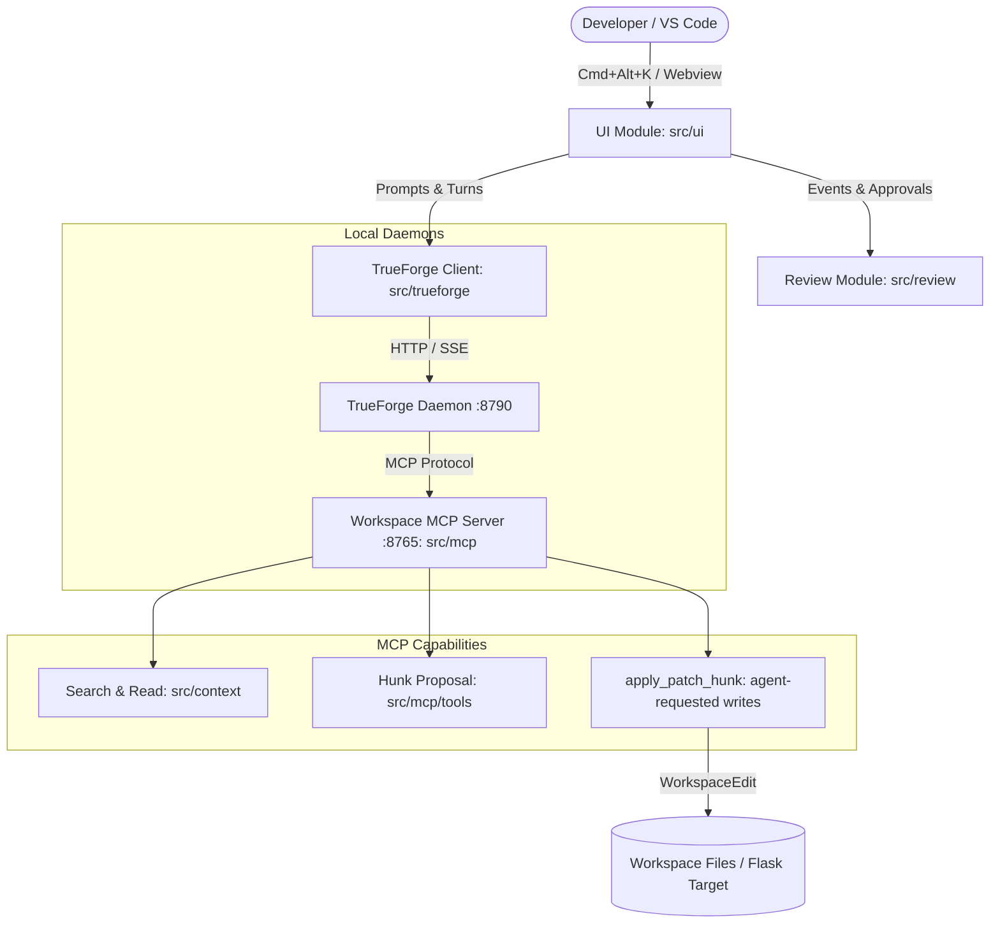

# Forge-Agent Architecture & System Design

## Data Flow
1. **Trigger**: Developer initiates a turn via inline edit (`Cmd+Alt+K`) or the Agent Panel.
2. **Orchestration**: The TrueForge client creates an execution turn with the local TrueForge daemon.
3. **Context Gathering**: The model issues MCP tool calls (`search_text`, `read_file`, `search_symbols`) to gather scoped workspace context.
4. **Patch Proposal**: Edits are staged in memory as unified diff hunks without mutating disk files.
5. **Human Review**: The Review module presents CodeLens `[Accept]` and `[Reject]` actions alongside native side-by-side diffs.
6. **Application**: If the agent is paused at `apply_patch_hunk`, Accept resumes that TrueForge turn and the tool applies the hunk. For proposals with no paused apply call (including inline edit), the explicit CodeLens Accept invokes the same guarded hunk-apply implementation from the extension. Both paths re-check cancellation and staleness, then record inverse edits. Whole-task Undo is a separate user action that applies those inverse edits.

`apply_patch_hunk` is the only MCP tool that writes files. Human-triggered CodeLens acceptance and whole-task Undo also write through the extension's review/undo modules; no model response or proposal writes to disk on its own.
